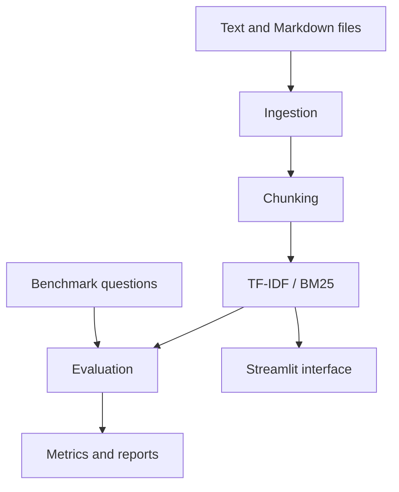

# RetrievalBench

A small, reproducible workbench for comparing lexical document retrieval methods and inspecting source passages.

## Why this project?

Retrieval-augmented generation (RAG) systems depend on retrieving useful evidence. RetrievalBench starts with a measurable retrieval baseline before adding answer generation. It compares TF-IDF and BM25 and reports Recall@k, Precision@k, mean reciprocal rank (MRR), and query latency.

## Current scope

- Load local `.txt` and `.md` files.
- Split documents into overlapping chunks while preserving source metadata.
- Retrieve passages using TF-IDF and BM25.
- Run a fixed benchmark question set.
- Inspect source passages in a Streamlit interface.
- Check whether citation identifiers exist among retrieved chunks.
- Run automated tests.

**Important limitation:** citation ID validity is not proof that a source supports a generated claim. This starter version does not generate answers and does not claim semantic groundedness evaluation.

## Architecture



## Setup

Python 3.10 or newer is recommended.

```bash
python -m venv .venv
```

Windows PowerShell:
```powershell
.\.venv\Scripts\Activate.ps1
```

macOS/Linux:
```bash
source .venv/bin/activate
```

Install the project and development dependencies:
```bash
pip install -e ".[dev]"
```

Run tests:
```bash
pytest -q
```

Run the dashboard:
```bash
streamlit run app.py
```

## Run a benchmark

From the repository root:

```bash
python - <<'PY'
from pathlib import Path
import sys
sys.path.insert(0, "src")
from retrievalbench.ingestion import load_text_documents, validate_documents
from retrievalbench.chunking import chunk_documents
from retrievalbench.retrieval import available_retrievers
from retrievalbench.benchmark import load_questions, run_benchmark, summarize_benchmark

docs = validate_documents(load_text_documents("data/sample_docs"))
chunks = chunk_documents(docs)
retrievers = available_retrievers(chunks)
questions = load_questions("data/benchmark_questions.json")
results = run_benchmark(retrievers, questions, k=5)
print(summarize_benchmark(results).to_string(index=False))
results.to_csv("benchmark_results.csv", index=False)
PY
```

The sample benchmark is a smoke-test dataset, not a scientifically representative evaluation. It contains only eight hand-authored questions and five small documents. Expand and validate the benchmark before making broad performance claims.

## Metrics

- **Recall@k:** fraction of known relevant documents found in the top k.
- **Precision@k:** relevant results in the top k divided by k.
- **MRR:** reciprocal rank of the first relevant result, averaged across questions.
- **Latency:** wall-clock retrieval time for each query. Small local measurements are noisy; repeat runs before comparing small differences.

The benchmark uses document-level relevance labels. Chunk-level ranking and document-level evaluation are not identical; describe this limitation in reports.

## Dataset and licensing

The included short sample documents and questions are authored for this starter project. When adding external documents, check their licenses and retain attribution. Do not commit private or sensitive documents.

## Roadmap

1. Improve the benchmark and relevance labels.
2. Add dense embeddings as an optional retrieval method.
3. Add hybrid retrieval.
4. Add answer generation behind an optional interface.
5. Evaluate answer correctness and claim-level support separately from citation ID validity.

## Resume guidance

Only claim results you have measured. Suggested template:

- Built a Python retrieval evaluation platform comparing TF-IDF and BM25 over **[N]** curated questions, measuring Recall@5, MRR, and retrieval latency.
- Developed a Streamlit dashboard for source inspection and reproducible benchmark reporting, with automated tests and CI.

Replace `[N]` and describe only features you have actually run and verified.
