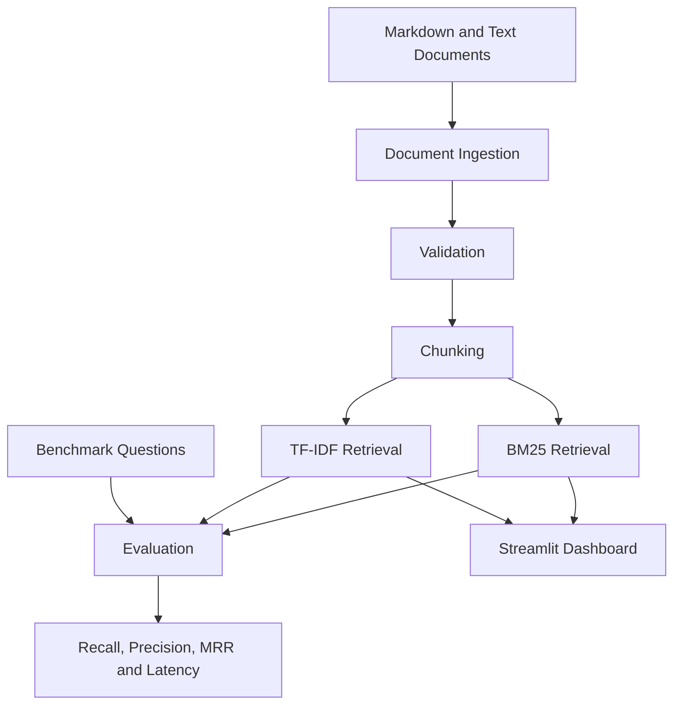

# 🔎 RetrievalBench

**A reproducible workbench for evaluating and comparing document retrieval methods.**

RetrievalBench is a Python-based project that compares **TF-IDF and BM25** retrieval methods on a small document corpus. It provides a benchmark pipeline, retrieval metrics, source inspection, and a Streamlit interface for exploring ranked results.

The goal is to establish a measurable retrieval baseline before extending the project toward more advanced Retrieval-Augmented Generation (RAG) systems.

## ✨ Features

- Load local Markdown and text documents.
- Split documents into overlapping chunks while preserving source metadata.
- Retrieve relevant passages using TF-IDF and BM25.
- Evaluate retrieval using Recall@k, Precision@k, Mean Reciprocal Rank (MRR), and latency.
- Load a fixed set of benchmark questions with document-level relevance labels.
- Inspect ranked results and source passages through a Streamlit dashboard.
- Check citation identifier validity against retrieved chunks.
- Run automated tests using pytest.
- Use GitHub Actions for continuous integration.

## 🧱 Architecture



## 🛠️ Technology Stack

- **Language:** Python
- **Retrieval:** scikit-learn TF-IDF and BM25
- **Data processing:** pandas
- **Interface:** Streamlit
- **Testing:** pytest
- **Code quality:** Ruff
- **CI:** GitHub Actions

## 📊 Latest Benchmark Results

The latest benchmark run used five sample documents and 30 hand-authored questions, with evaluation at \(k=5\).

| Metric | BM25 | TF-IDF |
|---|---:|---:|
| Recall@5 | 1.00 | 1.00 |
| Precision@5 | 0.20 | 0.20 |
| Mean Reciprocal Rank (MRR) | 1.00 | 1.00 |
| Retrieval latency | 0.2595 ms | 1.8505 ms |

### Interpretation

- **Recall@5:** Both methods retrieved the labeled relevant document within the top five results for every question in this run.
- **Precision@5:** Both methods achieved 0.20, equivalent to an average of one relevant result among five retrieved results under the current labels.
- **MRR:** Both methods achieved 1.00, indicating that the first labeled relevant result was ranked first for every question.
- **Latency:** BM25 had lower measured retrieval latency in this run.

BM25 was approximately 7.1 times faster than TF-IDF in this particular measurement. This is a preliminary observation, not a general performance guarantee.

### Benchmark Limitations

- The corpus contains only five short sample documents.
- The benchmark contains 30 hand-authored questions.
- Relevance labels are manually assigned and require independent validation against source content.
- Perfect retrieval metrics may reflect the small corpus and straightforward queries.
- Latency depends on the runtime environment, corpus size, implementation, and measurement conditions.
- Results should be repeated and tested on larger, more diverse datasets before making broader claims.

These results are intended as an initial baseline rather than a scientifically representative comparison.

## 📐 Evaluation Metrics

### Recall@k

The fraction of known relevant documents retrieved within the top \(k\) results.

\[
\operatorname{Recall@k} =
\frac{\text{Relevant documents retrieved in top }k}
{\text{Total relevant documents}}
\]

### Precision@k

The fraction of the top \(k\) retrieved results that are relevant.

\[
\operatorname{Precision@k} =
\frac{\text{Relevant results in top }k}{k}
\]

### Mean Reciprocal Rank (MRR)

Measures how highly the first relevant result is ranked.

\[
\operatorname{MRR} =
\frac{1}{N}\sum_{i=1}^{N}\frac{1}{r_i}
\]

Here, \(N\) is the number of queries and \(r_i\) is the rank of the first relevant result for query \(i\). Queries without a relevant result contribute zero.

### Retrieval Latency

Measures the time required to retrieve results for a query. Small local measurements can be noisy, so repeated runs and consistent measurement conditions are recommended.

**Evaluation note:** The benchmark uses document-level relevance labels while retrieval operates on chunks. Document-level and chunk-level ranking are not identical.

## 🔍 Retrieval Methods

### TF-IDF

Represents text using term frequency and inverse document frequency. The implementation uses vector similarity to rank candidate passages.

### BM25

A lexical ranking method that accounts for term frequency saturation and document-length normalization.

Both methods are useful baselines. Their performance depends on the corpus, query characteristics, preprocessing, and evaluation labels.

## 🚀 Getting Started

### Requirements

- Python 3.10 or newer
- pip
- Git

### 1. Clone the repository

```bash
git clone https://github.com/prajwalbhagewar68-maker/retrievalbench.git
cd retrievalbench
```

### 2. Create a virtual environment

```bash
python -m venv .venv
```

Windows PowerShell:

```powershell
.\.venv\Scripts\Activate.ps1
```

macOS/Linux:

```bash
source .venv/bin/activate
```

### 3. Install dependencies

```bash
python -m pip install --upgrade pip
pip install -e ".[dev]"
```

### 4. Run the automated tests

```bash
pytest -q
```

### 5. Launch the dashboard

```bash
streamlit run app.py
```

Open the local URL printed by Streamlit in your browser.

## 🧪 Run a Benchmark

Run the following command from the repository root:

```bash
python - <<'PY'
import sys

sys.path.insert(0, "src")

from retrievalbench.ingestion import (
    load_text_documents,
    validate_documents,
)
from retrievalbench.chunking import chunk_documents
from retrievalbench.retrieval import available_retrievers
from retrievalbench.benchmark import (
    load_questions,
    run_benchmark,
    summarize_benchmark,
)

docs = validate_documents(
    load_text_documents("data/sample_docs")
)
chunks = chunk_documents(docs)
retrievers = available_retrievers(chunks)
questions = load_questions("data/benchmark_questions.json")

results = run_benchmark(retrievers, questions, k=5)

print("Benchmark questions:", len(questions))
print(summarize_benchmark(results).to_string(index=False))

results.to_csv("benchmark_results.csv", index=False)
PY
```

The command prints the benchmark summary and saves the per-query results to `benchmark_results.csv`.

## 📁 Project Structure

```text
retrievalbench/
├── .github/
│   └── workflows/
│       └── tests.yml
├── data/
│   ├── sample_docs/
│   └── benchmark_questions.json
├── src/
│   └── retrievalbench/
│       ├── ingestion.py
│       ├── chunking.py
│       ├── retrieval.py
│       └── benchmark.py
├── tests/
├── app.py
├── pyproject.toml
└── README.md
```

## 🔒 Dataset and Licensing

The included short sample documents and benchmark questions are authored for this project.

When adding external documents:

- Check the applicable license.
- Preserve required attribution.
- Avoid committing private or sensitive information.
- Record dataset changes when comparing benchmark runs.

## ⚠️ Scope and Limitations

RetrievalBench is a retrieval evaluation workbench, not a complete RAG application.

- It does not currently generate answers.
- Citation identifier validity does not prove that a citation supports an answer claim.
- The current benchmark is small and manually labeled.
- Relevance labels require further validation.
- The included latency figures are specific to one runtime and one benchmark run.
- Dense and hybrid retrieval are not included in the current benchmark results.

## 🗺️ Roadmap

- [x] Implement TF-IDF retrieval.
- [x] Implement BM25 retrieval.
- [x] Add benchmark metrics and a question set.
- [x] Build a Streamlit interface.
- [x] Add automated tests and continuous integration.
- [x] Expand the benchmark question set to 30 questions.
- [ ] Independently validate relevance labels.
- [ ] Add repeated-run latency measurements.
- [ ] Evaluate Recall@3 and Precision@3 alongside top-five metrics.
- [ ] Add optional dense embedding retrieval.
- [ ] Explore hybrid retrieval.
- [ ] Add answer generation behind an optional interface.
- [ ] Evaluate answer correctness and claim-level groundedness separately from citation validity.

## 💼 Resume Guidance

Use only results and features you can demonstrate and explain.

**Suggested project entry:**

**RetrievalBench — Document Retrieval Evaluation Workbench**
- Built a Python retrieval evaluation platform comparing TF-IDF and BM25 across five sample documents and 30 benchmark questions.
- Implemented Recall@k, Precision@k, MRR, and query-latency reporting with a Streamlit interface for inspecting ranked passages.
- Added automated tests and a GitHub Actions workflow for continuous integration.

The current benchmark results are preliminary. Validate the relevance labels and repeat the measurements before presenting the scores as established performance claims.

## 👤 Author

**Prajwal Bhagewar**

GitHub: [@prajwalbhagewar68-maker](https://github.com/prajwalbhagewar68-maker)

---

*RetrievalBench is an educational and portfolio project focused on reproducible retrieval experiments and transparent evaluation.*
